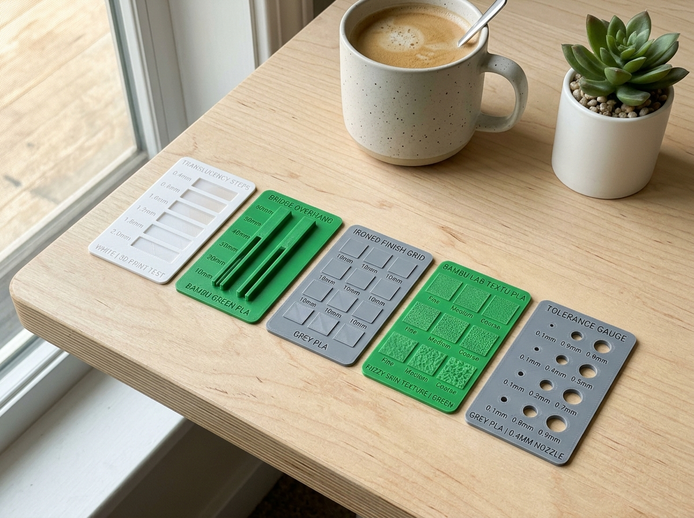
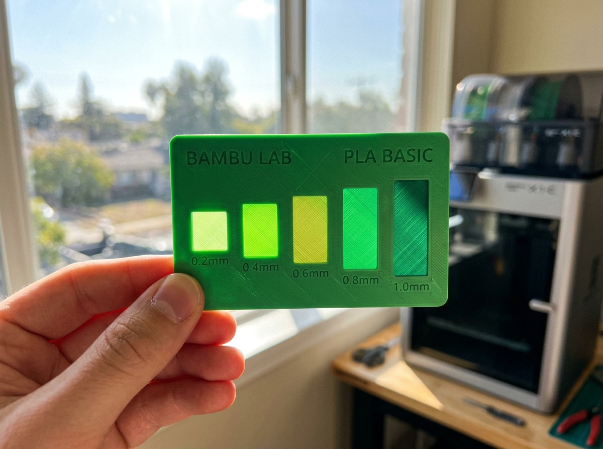
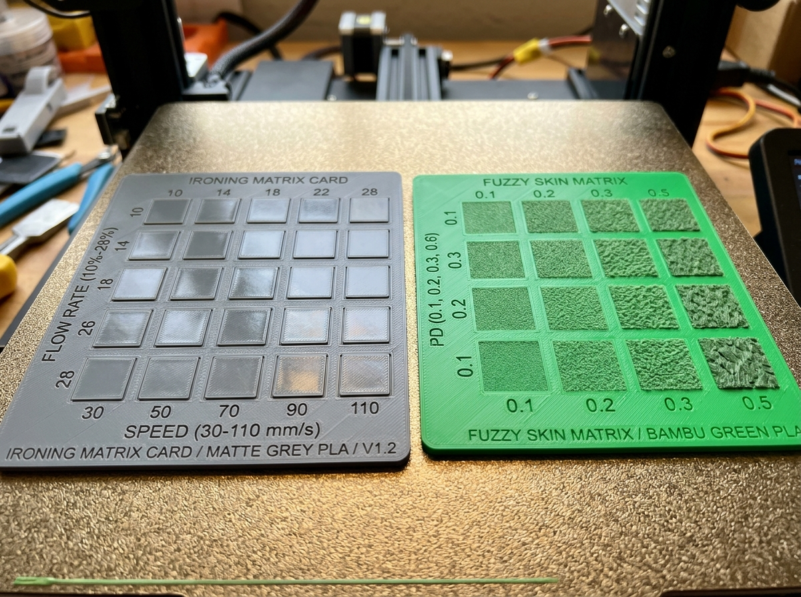
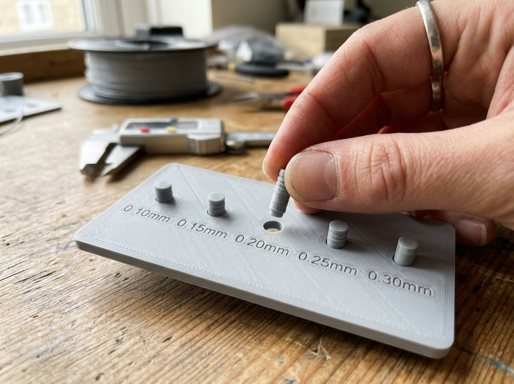

# Bambu Swatch & Calibration Studio
### 5-in-1 全能色票與極限校準卡系統 | MakerWorld 官方發布詳細指南

> **相容機型**：Bambu Lab X1-Carbon / P1S / P1P / A1 / A1 mini  
> **卡片規格**：85.0 × 50.0 mm（標準名片 / 信用卡尺寸）  
> **單張耗材**：約 9g ~ 14g | **列印時間**：約 25 ~ 35 分鐘

---

## 一、 寫在前面：為什麼設計這套校準卡？

每次開箱新耗材，你是不是也總是印一隻小船（Benchy）或是佔空間的階梯塔？這些模型印完後通常只能堆在角落，耗料又不易收納。更重要的是，它們很難幫你精準回答：
- *「這卷耗材在表面熨燙（Ironing）的最佳流量是多少？」*
- *「在懸空橋接（Bridge）能拉多長才不下垂？」*
- *「做可動鉸鏈與轉軸時需要留多少公差（Tolerance）？」*

為此，我們設計了這套標準 **85.0 × 50.0 mm（標準名片尺寸）** 的 5 合 1 極限校準卡系統。每張卡片重量僅約 9g ~ 14g，能輕鬆放入標準名片盒、活頁色票收納冊或掛在隨身鑰匙圈上，是 Bambu Lab 機主最優雅、省料且專業的耗材庫管理利器。

---

## 二、 五款核心校準卡特色與實測解析

### 1. 多階透光與綜合色票卡 (`01_Bambu_Swatch_Card`)
作為耗材檔案的代表色票，集成了最常用的光學與幾何指標：
- **5 階漸進透光窗**：由 0.2mm、0.4mm、0.6mm、0.8mm 至 1.0mm 漸層厚度，內嵌微浮雕圓環，在逆光下能一秒辨識耗材透光率（Lithophane 浮雕必備）。
- **微細線寬測試肋**：0.25mm、0.45mm、0.65mm、0.85mm 實體凸肋，直觀檢視細小壁厚與擠出飽滿度。
- **孔徑收縮檢驗**：D2.0mm、D3.0mm、D4.0mm 內孔，精確評估小孔收縮率。
- **光學反射階梯**：0.4mm、0.8mm、1.2mm、1.6mm 階梯，觀察材料在不同層高下的光澤反射與顏色飽和度變化。
- **永久規格銘牌**：深度 0.45mm 的沉頭凹字雕刻，印完後文字清晰銳利、永不磨損，切片無需額外上色即可一目了然。

---

### 2. 雙軌懸空橋接測試卡 (`02_Bambu_Bridge_Test_Card`)
告別下垂的懸空！雙軌懸空橋接卡專門用來抓取最佳橋接速度與冷卻風量：
- **雙軌連續懸空跨距**：跨距由 10mm 漸進增加至 50mm（以 10mm 為一階），覆蓋日常模型最常見的懸空跨度。
- **光學檢測窗**：雙軌下方設有鏤空透光窗，印完後只要對著光源一照，底層是否有散絲或垂落肉眼立刻分曉。
- **垂度階梯尺**：卡片右側提供 0.5mm ~ 2.0mm 的垂度落差標記，方便直接對照測量下垂量。

---

### 3. 表面熨燙 4x5 參數矩陣卡 (`03_Bambu_Ironing_Matrix_Card`)
這是 3D 列印界最受歡迎的「表面平整魔法」矩陣卡！過去測試表面熨燙需要重複切片好幾次，現在一盤搞定：
- **20 組參數組合**：4 排熨燙流量（10%, 15%, 20%, 25%）× 5 排行進間距（0.10, 0.13, 0.15, 0.18, 0.20 mm）。
- **官方 3MF 內建參數修改器**：提供的 3MF 專案檔中，已將 20 個方塊全部以 Bambu Studio 本地修改器（Modifier）顯式定義。你不需要手動設參數，匯入即可直接切片列印！
- **判讀方法**：側光照射卡片，找到最平滑、完全看不到擠出線、且沒有起泡拉絲的方塊，那組流量與間距就是該卷耗材的最佳黃金參數。

---

### 4. 垂直 Fuzzy Skin 4x4 紋理矩陣卡 (`04_Bambu_Fuzzy_Skin_Matrix_Card`)
想要消滅層紋、做出高級磨砂或類皮革手感？Fuzzy Skin（仿生毛刺）是最佳選擇：
- **16 組觸感方塊**：4 階毛刺厚度（0.1mm, 0.2mm, 0.3mm, 0.4mm）× 4 階點間距（0.2mm, 0.4mm, 0.6mm, 0.8mm）。
- **立體直觀實測**：採垂直立體排列，與工具握把、相機外殼的受力與視覺方向完全一致。
- **觸覺直覺選型**：方便手指親自觸摸盲測，快速挑選出最適合收納盒外殼、工具把手的防滑觸感。

---

### 5. 高精度間隙與活動公差卡 (`05_Bambu_Tolerance_Gauge_Card`)
設計活動鉸鏈、卡扣或齒輪前必備的驗證神器：
- **5 組高精度間隙**：0.10mm（極限緊配合/需輕敲）、0.15mm（緊密可動）、0.20mm（滑順轉動）、0.25mm、0.30mm（寬鬆游隙）。
- **4 種軸徑規格**：涵蓋 D3.0mm、D4.5mm、D6.0mm、D7.5mm 四種常用軸徑，共 20 組測試銷。
- **Print-in-Place 一轉即開**：一體成型免支撐，列印完成後手指輕輕旋轉即可脫開，立即可知你的印表機當前擠出率是否需要調整流量比（Flow Ratio）。

---

## 三、 Bambu Studio 官方推薦切片參數

本系列模型已通過拓撲半邊驗證（Watertight Manifold），無任何破面、非流形邊或反向面，開檔 0 警告，安心切片：

| 切片參數項目 | 推薦設定值 | 設計考量與說明 |
| :--- | :--- | :--- |
| **噴嘴口徑 (Nozzle)** | **0.4 mm** | 標準口徑，文字與細部結構最佳相容性 |
| **層高 (Layer Height)** | **0.20 mm Standard** | 首層 0.20mm，其餘 0.20mm，透光階梯每層精準對齊 |
| **外牆圈數 (Wall Loops)** | **2 圈** | 保證卡片結構剛性同時兼顧透光層厚度精準度 |
| **填充密度 (Infill)** | **15% 網格 (Grid) / 迴旋 (Gyroid)** | 低耗料且足以支撐 85x50 頂層平整封頂 |
| **熱床板種類 (Build Plate)** | **Textured PEI 或 Smooth PEI** | 推薦紋理 PEI 板，底部具有細膩金屬磨砂質感 |
| **熱床 / 噴嘴溫度** | **依耗材官方建議** | 色票規格銘牌已預刻建議溫度便於查閱 |
| **支撐材料 (Support)** | **完全不需要 (100% 免支撐)** | 全結構倒角均經過自支撐優化，拆板即用 |

---

## 四、 線上客製化產生器 (Web Studio) 介紹

除了發布在 MakerWorld 預設的 5 款標準 3MF 檔案外，我們同時開源了完整的前端 3D 參數化 Web Studio：
- **即時 3D 渲染預覽**：滑動任何參數（如噴嘴溫度、材質名稱、熨燙流量範圍），畫面以 60 FPS 即時反應 3D 外觀。
- **7 國語言介面**：支援繁體中文、英文、德文、法文、西班牙文、義大利文、荷蘭文，方便國際社群推廣。
- **生產級 3MF 打包**：內建完整的盤面定義、縮圖、零件組裝關係與切片器修改器，完全相容 MakerWorld 雲端切片與桌面版 Bambu Studio。

---

## 五、 下載與社群互動

- ❤️ **喜歡這個專案嗎？** 歡迎在 MakerWorld 點擊收藏（Collection）、點讚與評分！
- 📸 **上傳實印照片**：歡迎大家印完後上傳實拍照片，分享不同品牌耗材在表面熨燙與 Fuzzy Skin 的最佳參數，一起壯大耗材資料庫！
- 📜 **開源授權**：CC BY-NC-SA 4.0（個人列印與社群分享完全免費，歡迎標註出處進行非商業二次創作）。
